# Guía visual · Portal de Azure en Windows · Módulo 1

**Para quién:** alumno del P.E. Data Engineer · **Equipo:** Windows 10 u 11 · **Navegador:** Microsoft Edge o Google Chrome · **Duración:** 25 minutos.
**Qué logras:** ubicar tu suscripción, generar tus nombres con el sistema del curso, crear tu grupo de recursos con etiquetas y estimar un costo.

> Las capturas están en inglés porque el portal se muestra en el idioma del navegador. Si el tuyo está en español, los botones dicen lo mismo: «Crear», «Revisar y crear», «Etiquetas». Nombres, etiquetas y pasos son idénticos.
> En las capturas el alumno de ejemplo es `demo`. **Tú usarás tu propio token de alumno.**

## Antes de empezar
- Una cuenta Microsoft (outlook, hotmail o la de tu empresa) y acceso a una suscripción de Azure.
- Si no tienes suscripción: cuenta gratuita en https://azure.microsoft.com/free. Suele pedir una tarjeta de verificación y un teléfono, y **las condiciones cambian: léelas antes de aceptar**. *(Sin capturas aquí: el registro pide datos personales.)*
- Si tu empresa bloquea el acceso a Azure, avisa al instructor: sigue el **plan B** (observas la demo y haces los pasos 3 a 6 sin nube).

---

## Paso 1 · Ingresa al portal y ubica tu suscripción (3 min)
1. Abre https://portal.azure.com e inicia sesión.
2. Verás la pantalla de inicio. Usa el buscador de arriba para llegar a cualquier servicio.

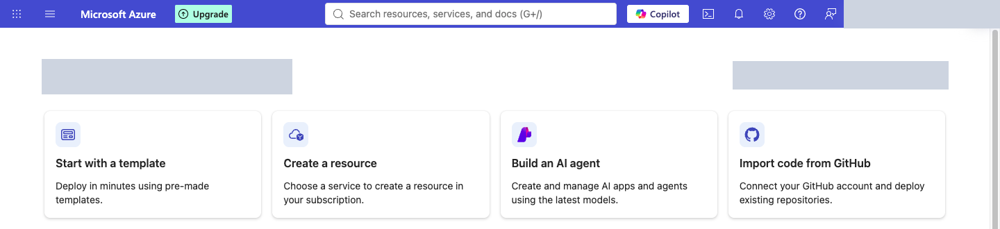

3. En el buscador escribe **Subscriptions** y ábrelo. Ubica tu suscripción, tu rol y su estado.

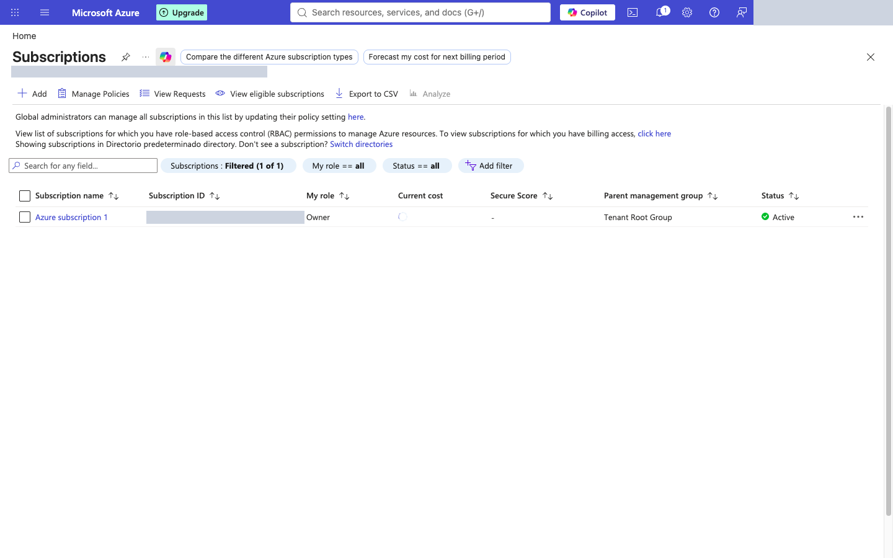

**Aceptación:** tu suscripción aparece con estado **Active** y tu rol es **Owner** o **Contributor**. *Si compartes la captura, tapa el identificador.*

---

## Paso 2 · Genera tus nombres y crea tu grupo de recursos (7 min)
### 2.1 Genera los nombres
1. Abre `herramientas\generador-nombres.html` con doble clic (se abre en tu navegador, sin instalar nada).
2. Escribe tu token de **alumno**: inicial del nombre + apellido, 3 a 6 caracteres, sin tildes ni ñ (ej.: Manuel Argüelles → `margue`).
3. Elige la región. Si dudas, `brs · Brazil South` (verifica que aparezca en tu lista, ver 2.3).
4. Confirma que todas las filas digan **✓ válido**. Copia el nombre del grupo de recursos con el botón **Copiar** (en Windows: también `Ctrl+C`).

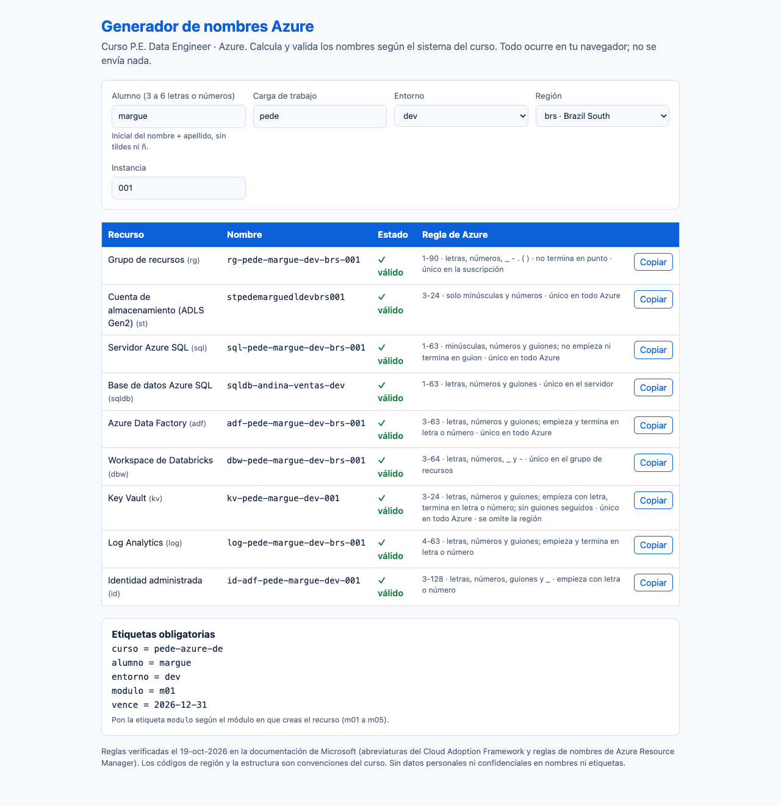

**Aceptación:** pegas en tu ficha la tabla de los nombres del set completo (grupo, almacenamiento, servidor SQL, Data Factory, Databricks, Key Vault).

### 2.2 Abre el formulario
En el portal busca **Resource groups** y pulsa **+ Create**.

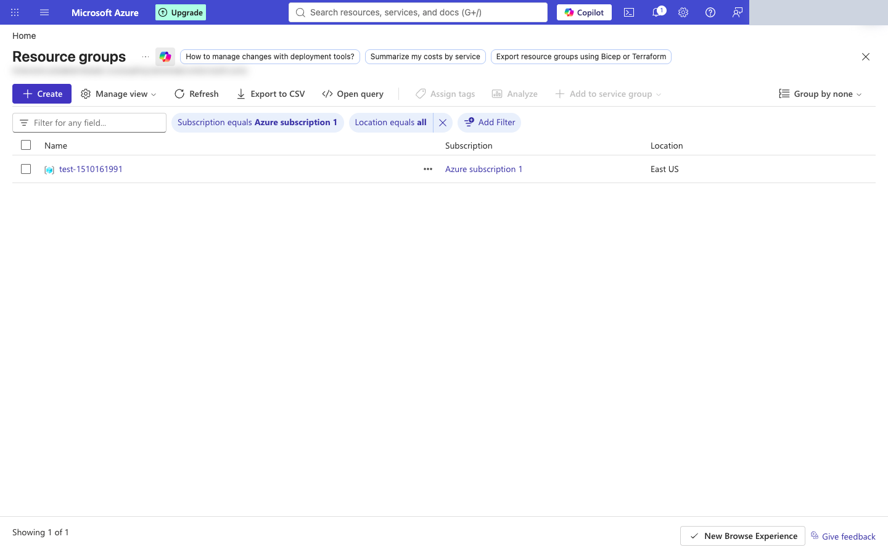

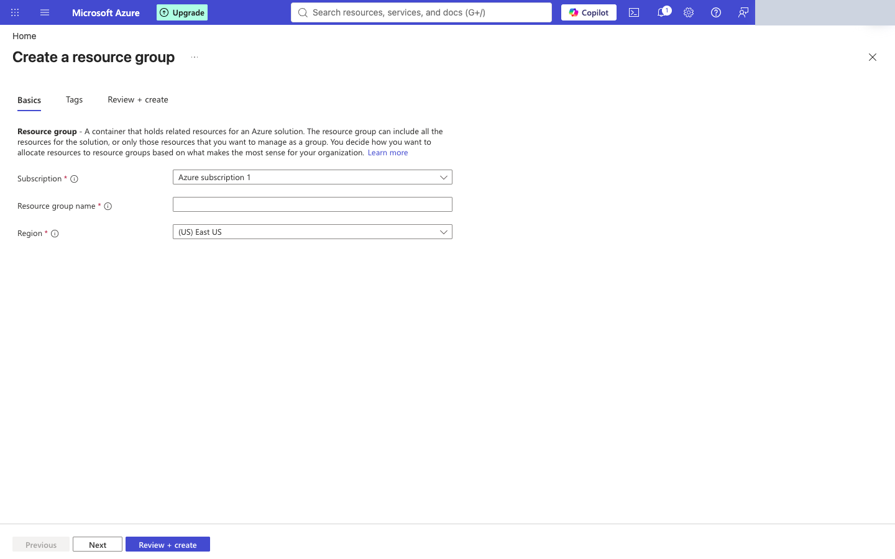

### 2.3 Completa «Basics»
- **Subscription:** la tuya.
- **Resource group name:** pega el nombre generado (ej.: `rg-pede-margue-dev-brs-001`).
- **Region:** elige la región. **No se puede cambiar después.** La lista muestra solo las regiones disponibles para tu suscripción.

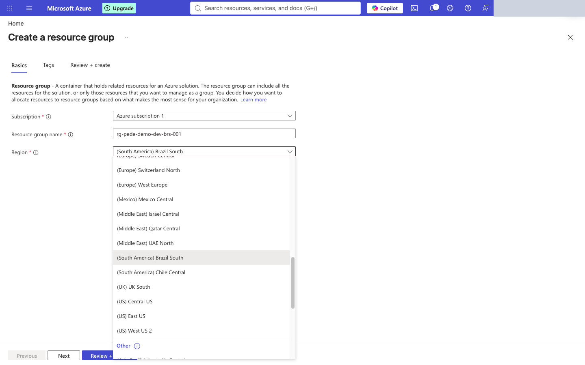

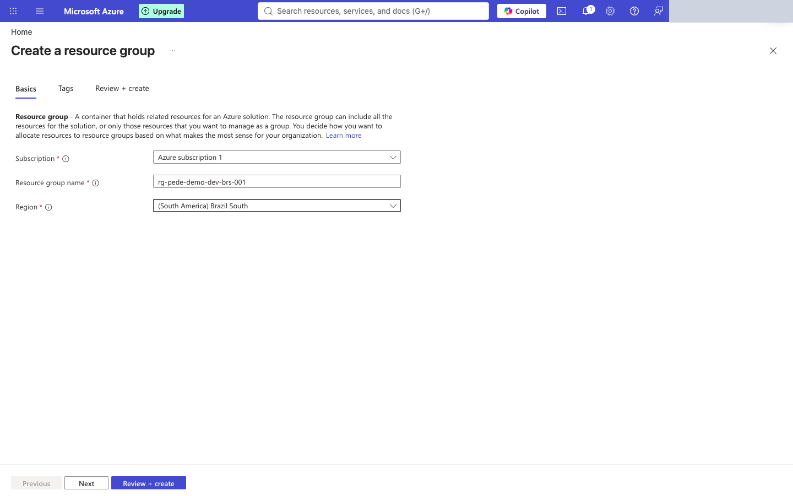

### 2.4 Agrega las 5 etiquetas («Tags»)
| Name | Value |
|---|---|
| `curso` | `pede-azure-de` |
| `alumno` | tu token |
| `entorno` | `dev` |
| `modulo` | `m01` |
| `vence` | `2026-12-31` |

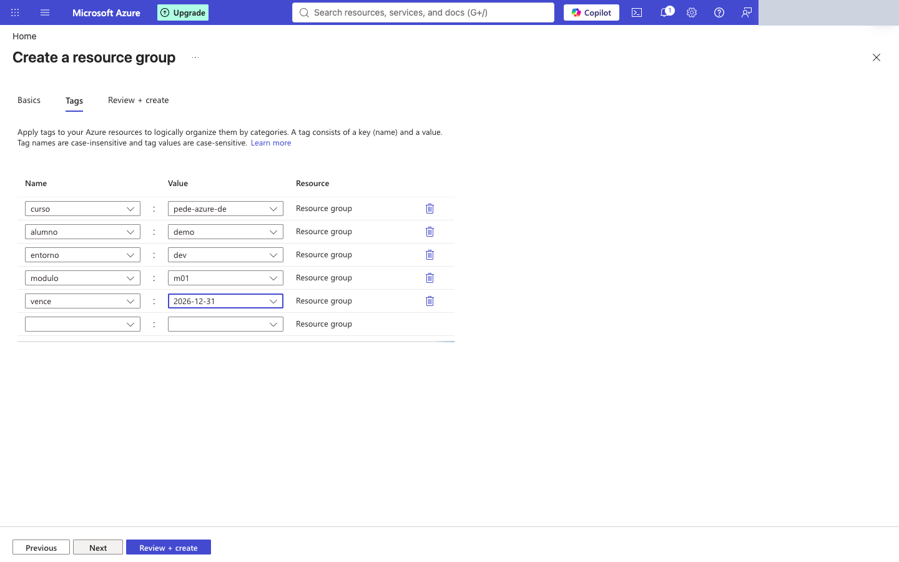

### 2.5 Revisa y crea
Pulsa **Review + create**, revisa el resumen y pulsa **Create**.

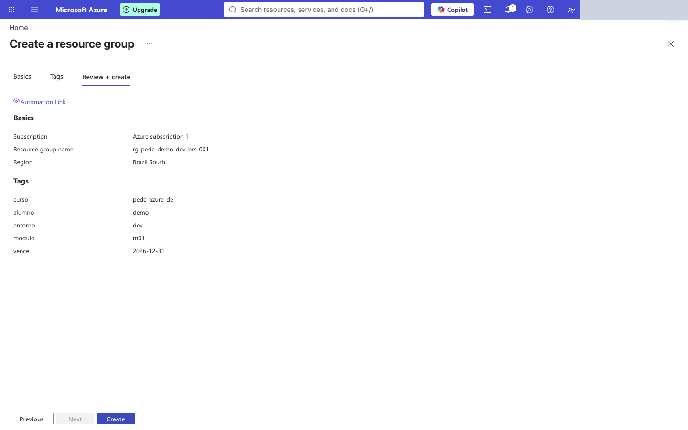

### 2.6 Comprueba
Vuelve a **Resource groups**: tu grupo aparece en la lista. Ábrelo.

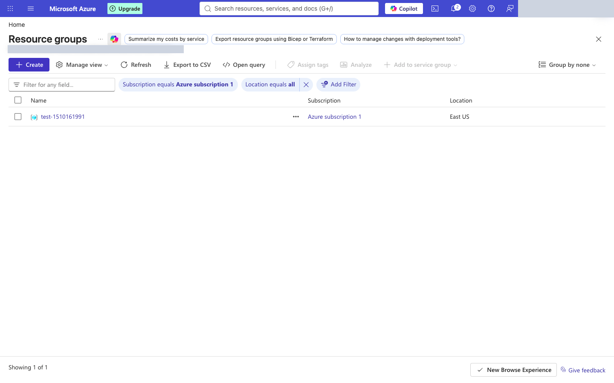

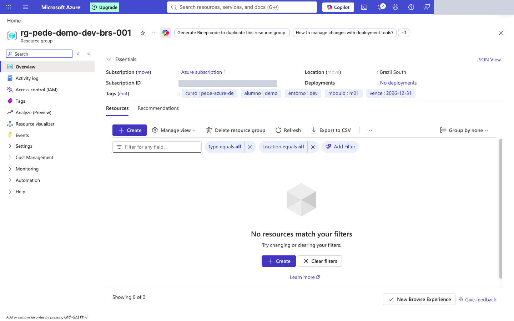

**Aceptación:** el grupo existe, con tu nombre generado, la región elegida, las 5 etiquetas y **0 recursos**.

---

## Paso 3 · Clasifica 8 servicios (4 min) — sin nube
Completa la tabla de `lab\plantilla-ficha.md`: Virtual Machines, Virtual Network, Azure SQL Database, Azure App Service, Azure Functions, Microsoft 365, Power BI y Azure Databricks → IaaS, PaaS, SaaS o serverless.

## Paso 4 · Estima el costo de 1 TB de almacenamiento (4 min) — sin cuenta
1. Abre https://azure.microsoft.com/pricing/calculator/ y pulsa **Add to estimate** en **Storage Accounts**.

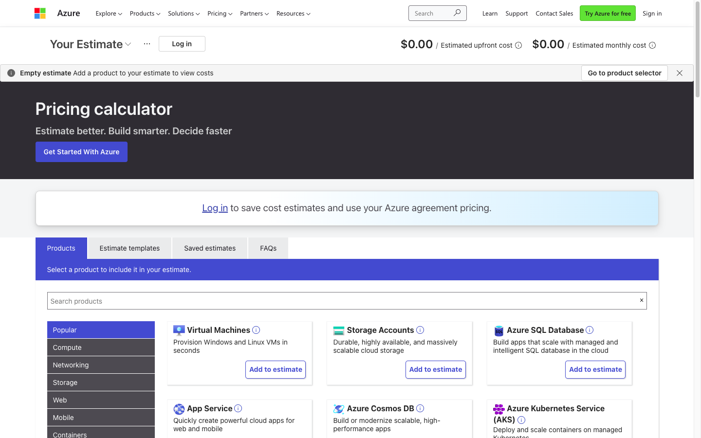

2. Ajusta: región, **Capacity = 1000 GB**, nivel de acceso y redundancia. Fíjate en **File Structure**: *Flat Namespace* es el almacenamiento común; **Hierarchical Namespace** es el que convierte la cuenta en **ADLS Gen2** (lo usaremos en el módulo 4).

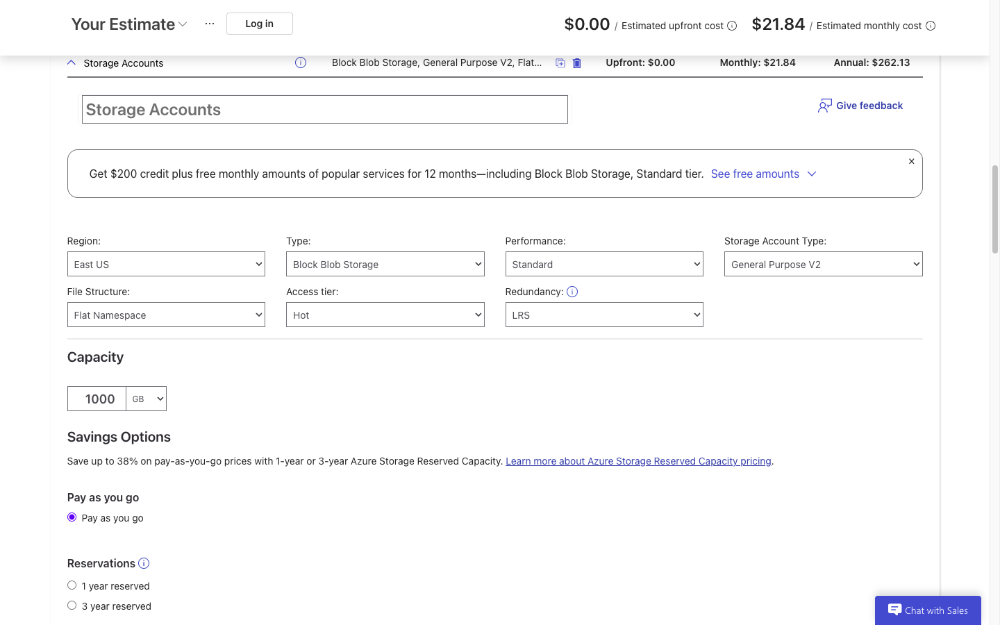

3. Anota en la ficha: **fecha**, región, nivel de acceso, redundancia y resultado. **Es una estimación, no un precio garantizado.**

**Aceptación:** la ficha tiene fecha, región, supuestos y resultado.

## Pasos 5 y 6 · Equivalencias y ficha de decisión (7 min) — sin nube
Sigue `lab\CONSIGNA.md`.

---

## Al terminar el curso: borra lo que creaste
Un grupo de recursos se borra completo, con todo lo que contiene. **No lo hagas hoy:** lo usaremos en el módulo 2.
1. Abre el grupo → **Delete resource group**.
2. Escribe el nombre exacto para confirmar y pulsa **Delete**.
3. **Aparece una segunda confirmación**: pulsa **Delete** otra vez. Si no la confirmas, el grupo no se borra.

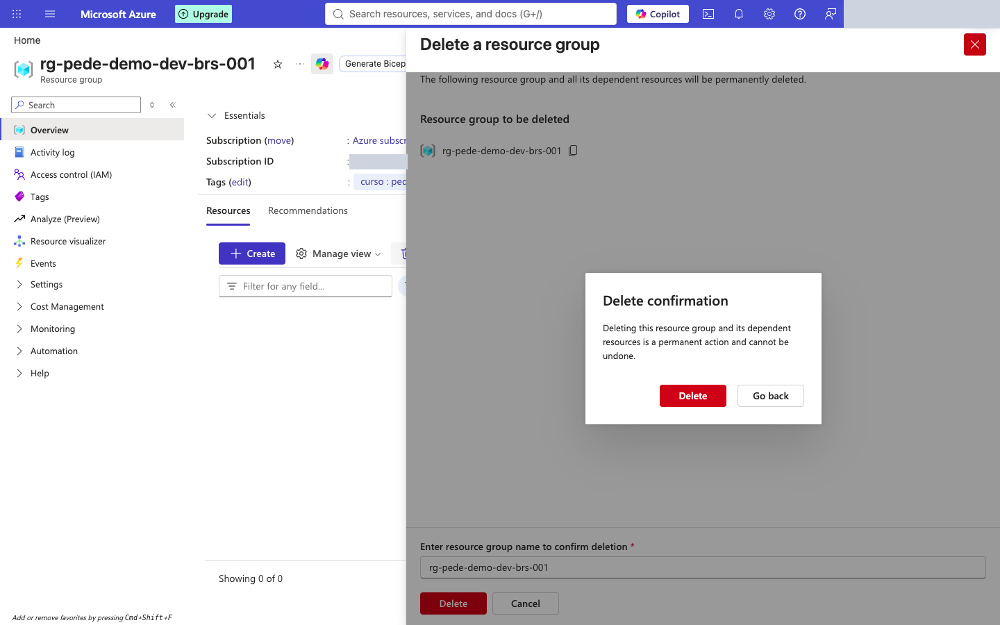

---

## Extra (opcional): el mismo grupo desde PowerShell
Útil para repetir la creación sin usar el mouse. *No es necesario para el laboratorio y no se probó en Windows: la ruta oficial es el portal.*
```powershell
winget install -e --id Microsoft.AzureCLI      # una sola vez; abre una terminal nueva después
az login
az group create --name rg-pede-margue-dev-brs-001 --location brazilsouth `
  --tags curso=pede-azure-de alumno=margue entorno=dev modulo=m01 vence=2026-12-31
```
El acento grave (`) es el carácter de continuación de línea en PowerShell. Sustituye `margue` por tu token.

## Problemas frecuentes
| Síntoma | Causa probable | Qué hacer |
|---|---|---|
| El generador marca un nombre en rojo | Token con tildes, ñ o más de 6 caracteres | Corrige el token |
| «The resource group name is invalid» | Caracteres no permitidos en el nombre | Usa el nombre generado, sin editarlo |
| La región que quieres no aparece | La suscripción no la ofrece | Elige otra de la lista y anótalo en la ficha |
| No puedes crear el grupo | Tu rol no es Owner/Contributor o falta permiso | Avisa al instructor |
| Te redirige a la cuenta de tu empresa | Sesión de otro directorio | Abre una ventana InPrivate o cambia de directorio |

## Referencias
- Sistema de nombres del curso: `guias\00-sistema-de-naming.md`
- Portal: https://portal.azure.com · Calculadora: https://azure.microsoft.com/pricing/calculator/
