# Guía visual · Conectar Databricks al lago con Unity Catalog

> Caso real del curso: cuenta `stpededemobrs001`, workspace `dbw-pede-demo-brs-001`, catálogo `pede`.
> Todas las capturas son del portal y del workspace reales.

## Antes de empezar

| Recurso | Nombre en el curso | Dónde |
|---|---|---|
| Resource group | `rg-pede-demo-dev-brs-001` | Brazil South |
| Storage | `stpededemobrs001` | Brazil South |
| Workspace | `dbw-pede-demo-brs-001` | Premium, UC habilitado |
| Access connector | `ac-pede-demo-brs-001` | Mismo RG |
| Key Vault | `kv-pede-demo-brs-001` | Access policy |

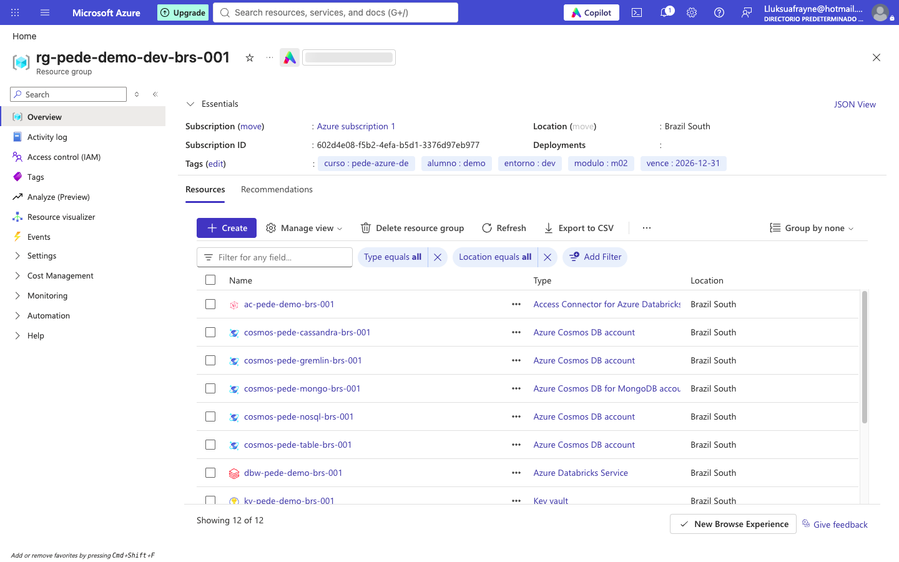

---

## Paso 1 · Crear el workspace

**Portal → Azure Databricks → Create.**

| Campo | Valor |
|---|---|
| Resource group | `rg-pede-demo-dev-brs-001` |
| Workspace name | `dbw-pede-demo-brs-001` |
| Region | Brazil South |
| Pricing tier | **Premium** (requisito de Unity Catalog) |

Al terminar, **Overview** debe mostrar `Status: Active` y la URL del workspace.

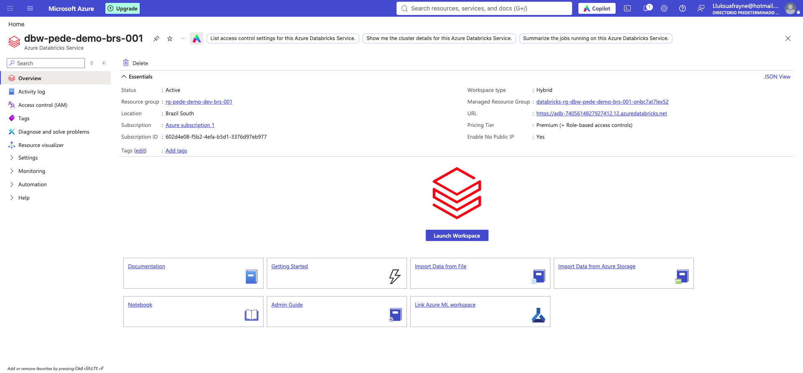

> **Costo:** el workspace no consume VM. El gasto aparece cuando se enciende cómputo.

---

## Paso 2 · Crear el access connector

**Portal → Create → Access Connector for Azure Databricks.**

| Campo | Valor |
|---|---|
| Resource group | `rg-pede-demo-dev-brs-001` |
| Name | `ac-pede-demo-brs-001` |
| Region | Brazil South |
| Identity | System assigned |

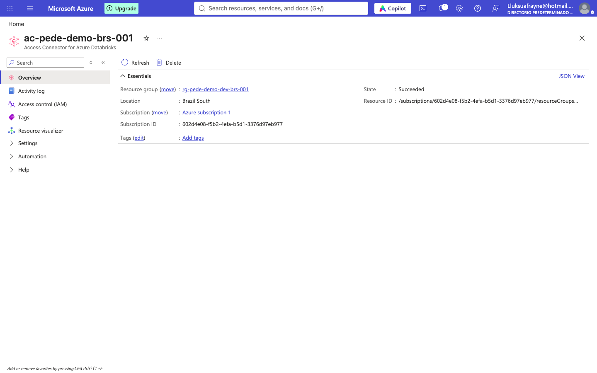

Después, en el **storage account → Access control (IAM) → Add role assignment**:

- Rol: **Storage Blob Data Contributor**
- Miembro: la identidad administrada del conector (`ac-pede-demo-brs-001`).

```bash
az role assignment create \
  --assignee-object-id <principal-id-del-conector> \
  --assignee-principal-type ServicePrincipal \
  --role "Storage Blob Data Contributor" \
  --scope /subscriptions/<sub>/resourceGroups/rg-pede-demo-dev-brs-001/providers/Microsoft.Storage/storageAccounts/stpededemobrs001
```

**Verificación:** el conector aparece en IAM del storage con el rol asignado.

> El rol se da a la **identidad**, no a una persona. Así el acceso no depende de quién esté logueado.

---

## Paso 3 · Crear la storage credential en Databricks

**Databricks → Catalog → Create → Create a credential.**

| Campo | Valor |
|---|---|
| Credential type | Azure Managed Identity |
| Credential name | `cred-pede-brs` |
| Access connector ID | `/subscriptions/.../accessConnectors/ac-pede-demo-brs-001` |

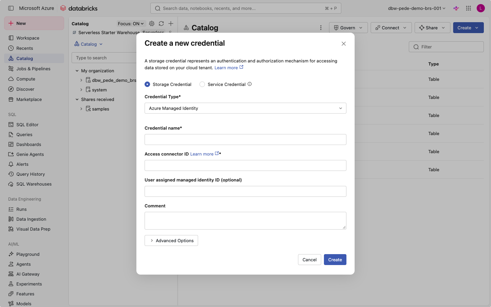

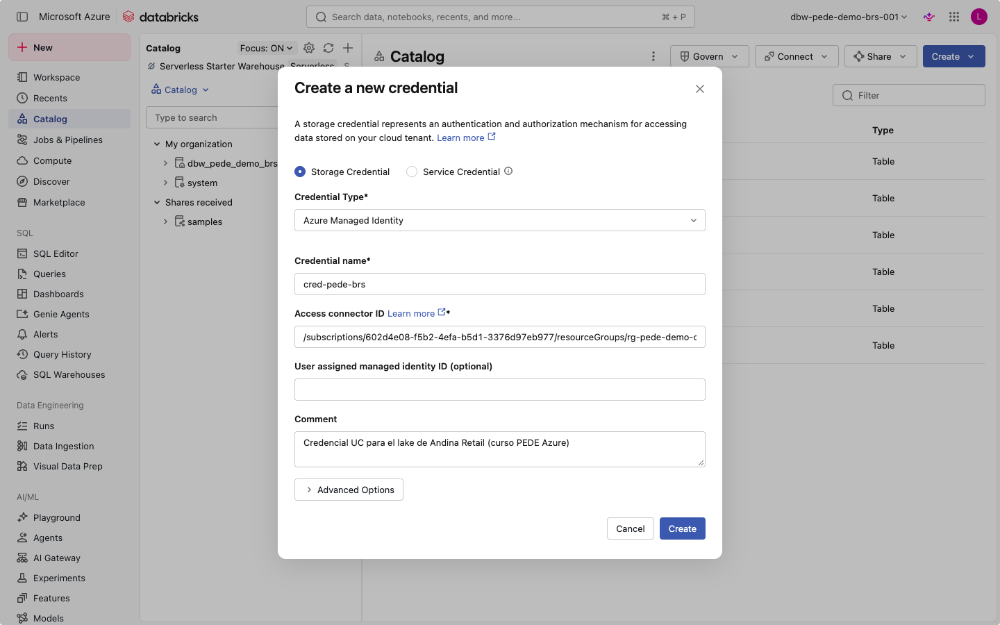

**Verificación:** la credencial queda con `Credential Type: Managed Identity` y el connector ID correcto.

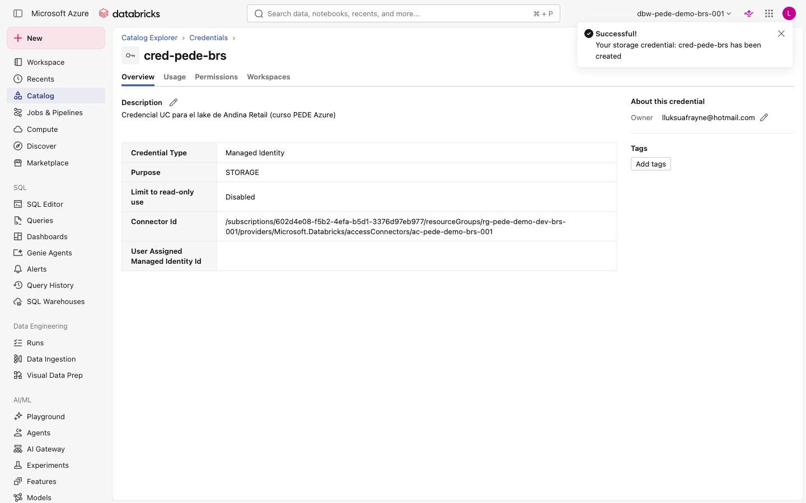

> La credencial no guarda claves: solo referencia la identidad del conector.

---

## Paso 4 · Crear las external locations

**Databricks → Catalog → Create → Create an external location.**

| Campo | Valor |
|---|---|
| Name | `ext_pede_bronze` |
| Storage type | Azure Data Lake Storage |
| URL | `abfss://bronze@stpededemobrs001.dfs.core.windows.net/` |
| Storage credential | `cred-pede-brs` |

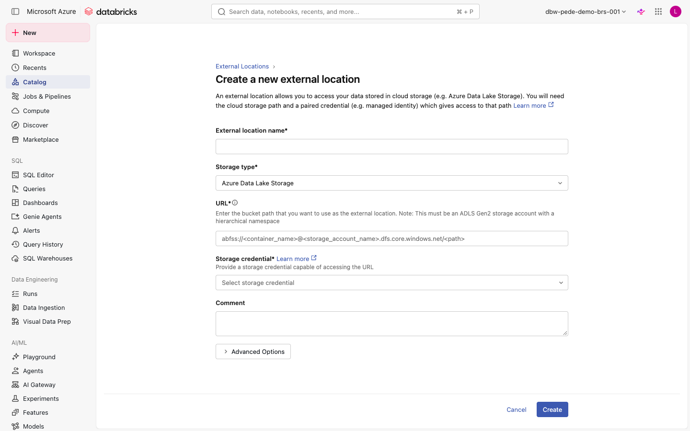

Repite para `ext_pede_silver` y `ext_pede_gold`.

**Alternativa por SQL** (más rápida y reproducible en clase):

```sql
CREATE EXTERNAL LOCATION IF NOT EXISTS ext_pede_bronze
URL 'abfss://bronze@stpededemobrs001.dfs.core.windows.net/'
WITH (STORAGE CREDENTIAL `cred-pede-brs`)
COMMENT 'Zona bronce del lake de Andina Retail';
```

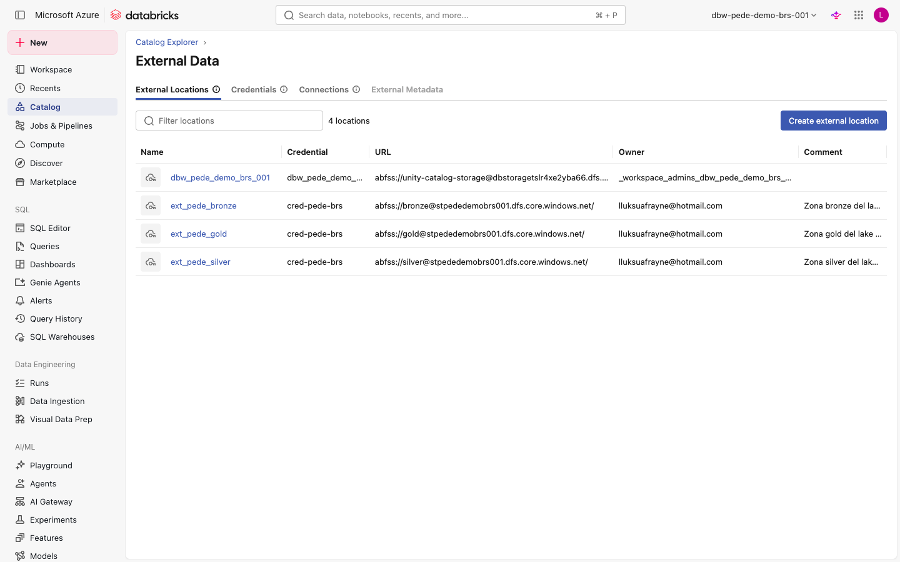

**Verificación:** tres rutas autorizadas, todas con `cred-pede-brs`.

> Si la UI muestra `Could not access location`, revisa el connector ID y el rol antes de forzar la creación.

---

## Paso 5 · Crear el catálogo y los schemas

**Catalog → Create → Create a catalog.**

| Campo | Valor |
|---|---|
| Catalog name | `pede` |
| Storage location | `abfss://gold@stpededemobrs001.dfs.core.windows.net/pede_catalog` |

Luego crea los schemas `bronze`, `silver` y `gold` dentro de `pede`.

**Por SQL:**

```sql
CREATE CATALOG IF NOT EXISTS pede
  MANAGED LOCATION 'abfss://gold@stpededemobrs001.dfs.core.windows.net/pede_catalog';

CREATE SCHEMA IF NOT EXISTS pede.bronze;
CREATE SCHEMA IF NOT EXISTS pede.silver;
CREATE SCHEMA IF NOT EXISTS pede.gold;
```

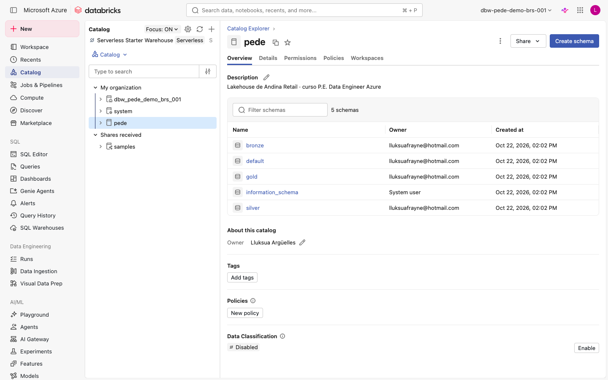

**Verificación:** `pede.bronze` existe y es visible en el explorador de catálogo.

---

## Paso 6 · Crear el Key Vault y el secreto

**Portal → Key Vault → Create.**

| Campo | Valor |
|---|---|
| Name | `kv-pede-demo-brs-001` |
| Region | Brazil South |
| Permission model | **Vault access policy** (no RBAC) |
| Soft-delete | 7 días |

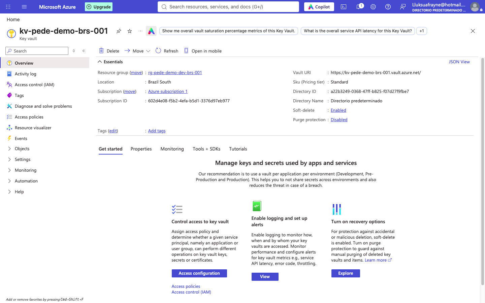

**Secreto:** `Secrets → Generate/Import`.

| Campo | Valor |
|---|---|
| Name | `pede-demo-secret` |
| Value | generar al azar; no se comparte |
| Enabled | Sí |

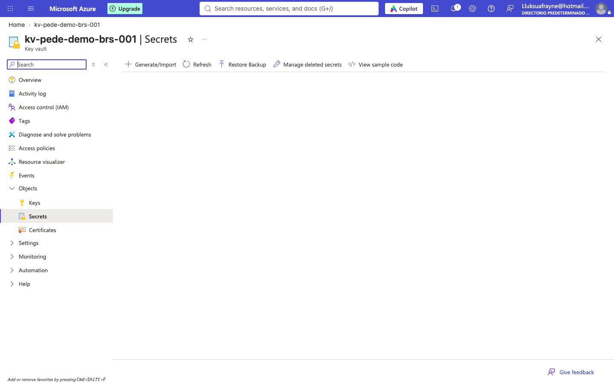

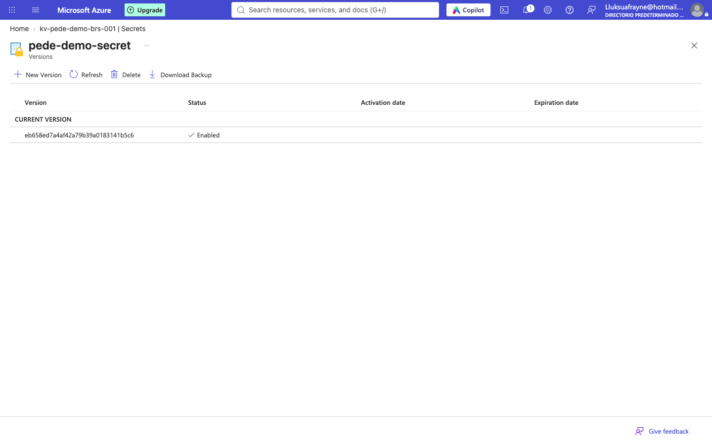

> El modelo **Vault access policy** es obligatorio para un scope AKV-backed. Si el vault está en RBAC, el scope falla.

---

## Paso 7 · Crear el scope respaldado por Key Vault

**Databricks → (URL del workspace) `#secrets/createScope`** o por API:

```bash
curl -X POST "$DATABRICKS_HOST/api/2.0/secrets/scopes/create" \
  -H "Authorization: Bearer $TOKEN" \
  -H "Content-Type: application/json" \
  -d '{
    "scope": "kv-pede",
    "scope_backend_type": "AZURE_KEYVAULT",
    "backend_azure_keyvault": {
      "resource_id": "/subscriptions/<sub>/resourceGroups/rg-pede-demo-dev-brs-001/providers/Microsoft.KeyVault/vaults/kv-pede-demo-brs-001",
      "dns_name": "https://kv-pede-demo-brs-001.vault.azure.net/"
    }
  }'
```

**Verificación:**

```bash
curl "$DATABRICKS_HOST/api/2.0/secrets/list?scope=kv-pede" \
  -H "Authorization: Bearer $TOKEN"
# {"secrets":[{"key":"pede-demo-secret", ...}]}
```

> En workspaces nuevos la UI clásica de secrets puede estar retirada. El scope sigue existiendo y se administra por API o CLI.

---

## Paso 8 · Leer el CSV y crear la tabla Delta

En el **SQL Editor**, con el SQL warehouse seleccionado:

```sql
SELECT COUNT(*) FROM read_files(
  'abfss://bronze@stpededemobrs001.dfs.core.windows.net/pedidos/fecha_carga=2026-10-10/orders.csv',
  format => 'csv', header => true, inferSchema => true
);
-- 10
```

```sql
CREATE OR REPLACE TABLE pede.bronze.orders
USING DELTA
LOCATION 'abfss://bronze@stpededemobrs001.dfs.core.windows.net/delta/orders'
AS
SELECT *,
       'abfss://bronze@stpededemobrs001.dfs.core.windows.net/pedidos/fecha_carga=2026-10-10/orders.csv' AS _source_file,
       '2026-10-10' AS _load_date,
       current_timestamp() AS _ingested_at
FROM read_files(
  'abfss://bronze@stpededemobrs001.dfs.core.windows.net/pedidos/fecha_carga=2026-10-10/orders.csv',
  format => 'csv', header => true, inferSchema => true
);
```

**Verificación:** la tabla aparece en Catalog como **External / Delta**.

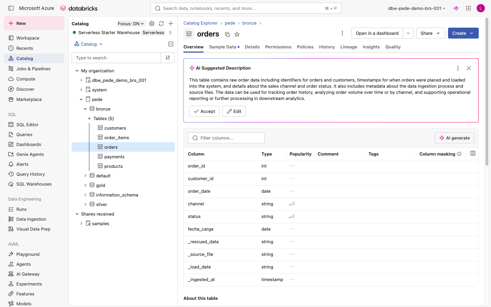

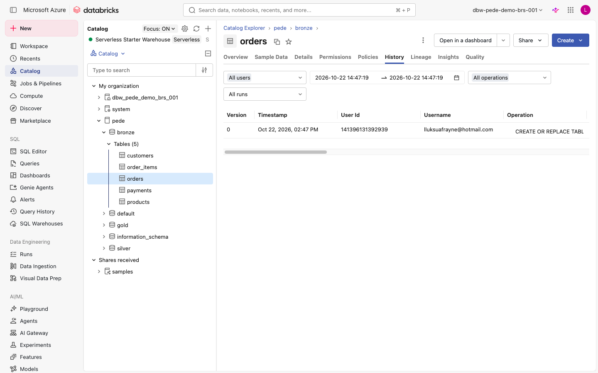

---

## Por qué el laboratorio no usa un clúster

En el workspace de la demo, Databricks no aprovisiona el clúster: queda en `Pending` (`Finding instances`) y no se crea la VMSS, aunque la suscripción sí puede crear VMs. Se probó en Brazil South y East US, single y multi-node, con varios tamaños. Por eso el laboratorio usa el **SQL warehouse serverless**, que ejecuta la misma lógica.

Si tu cuenta sí tiene cuota, el notebook `lab/notebooks/01_load_bronze_andina.py` hace exactamente lo mismo con PySpark en un clúster.

## Errores que ya vimos en el montaje

| Síntoma | Causa real | Solución |
|---|---|---|
| `Could not access location` en la UI | El selector de credencial no quedó registrado, o connector ID mal | Revisar el ID o crear la location por SQL |
| `ValidateCredential Missing one of...` | La credencial no se seleccionó en el formulario | Volver a elegirla y crear sin cerrar el desplegable |
| Scope AKV no se crea | El vault está en RBAC | Cambiar a Vault access policy |
| `Sin acceso` en el portal | Token de un directorio distinto | Cambiar de directorio o recargar sesión |
| Clúster en `Pending` | El workspace no aprovisiona el clúster | Usar serverless / SQL warehouse |
