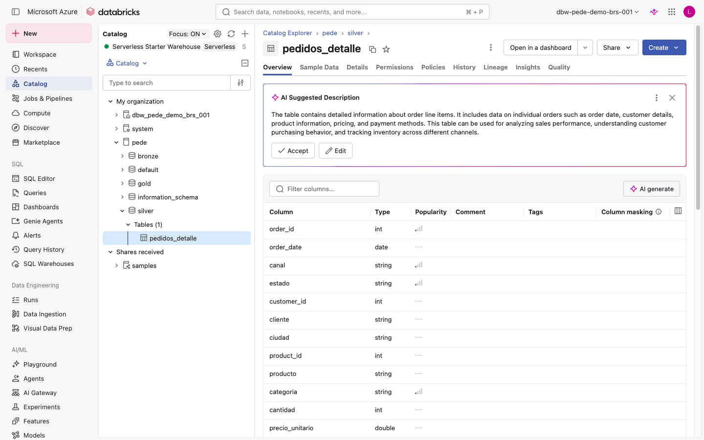
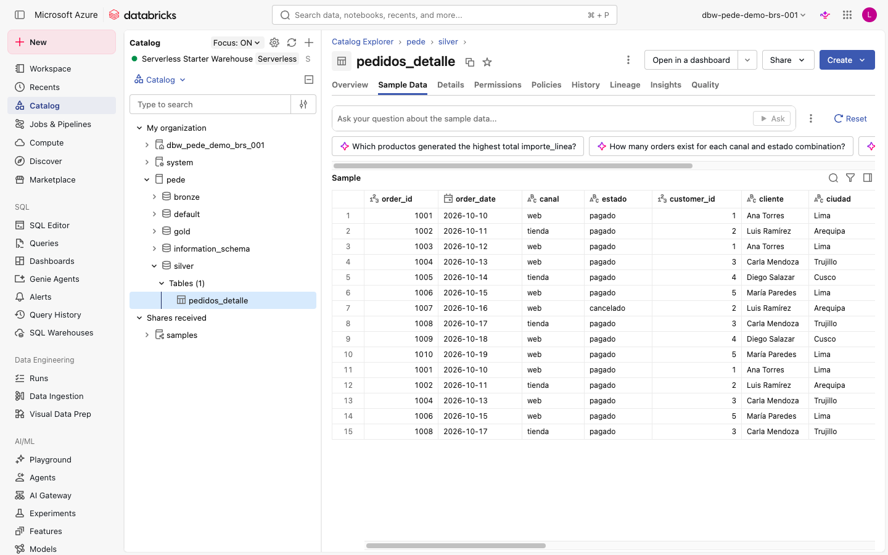
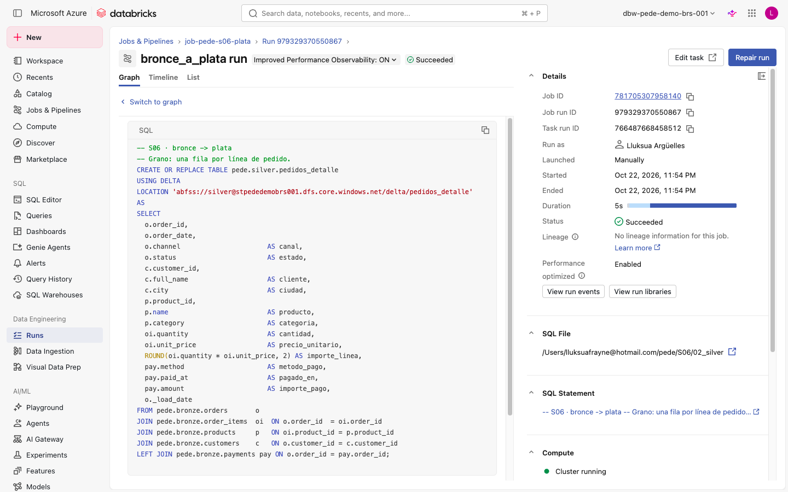
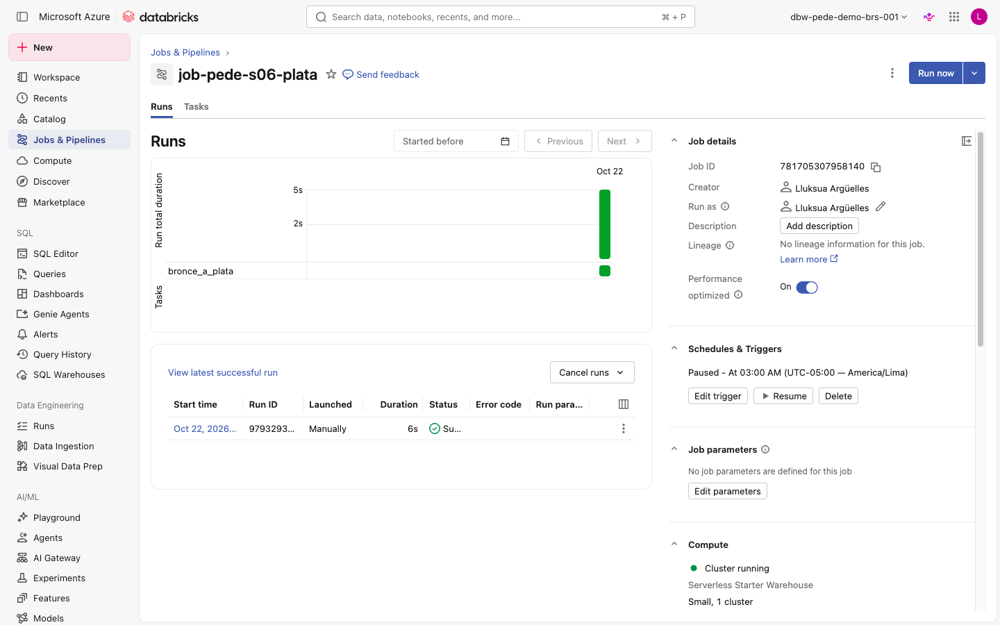
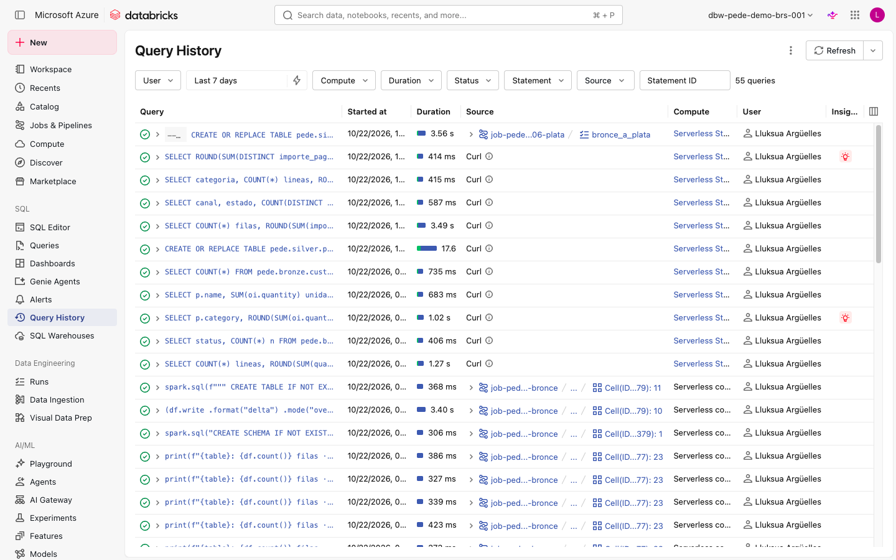
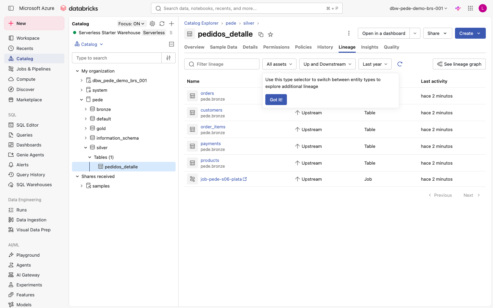

# Guía visual · Consolidar bronce a plata y programar el job

> Caso real: `pede.bronze` (S05) → `pede.silver.pedidos_detalle` → `job-pede-s06-plata`.
> Capturas del workspace `dbw-pede-demo-brs-001`.

## Antes de empezar

| Pieza | Dónde | Estado |
|---|---|---|
| Cinco tablas bronce | `pede.bronze` | Creadas en S05 |
| SQL warehouse | Compute → SQL warehouses | `Serverless Starter Warehouse` |
| Archivo SQL | Workspace → `pede/S06/02_silver` | `material/s06/lab/02_silver.sql` |

---

## Paso 1 · Verificar el bronce

Abre el **SQL Editor**, elige el warehouse y ejecuta el conteo de las cinco tablas.

**Esperado:** 5, 8, 10, 15 y 9.

Si un número no coincide, no sigas: la plata hereda el error.

---

## Paso 2 · Crear el archivo SQL de la consolidación

**Workspace → Create → File → SQL** (o importa `02_silver.sql`).

El archivo tiene una sola consulta:

```sql
CREATE OR REPLACE TABLE pede.silver.pedidos_detalle
USING DELTA
LOCATION 'abfss://silver@stpededemobrs001.dfs.core.windows.net/delta/pedidos_detalle'
AS
SELECT ... FROM pede.bronze.orders o
JOIN pede.bronze.order_items oi ON ...
LEFT JOIN pede.bronze.payments pay ON ...;
```

| Decisión | Por qué |
|---|---|
| `JOIN` con líneas, productos y clientes | Aportan el detalle y las dimensiones |
| `LEFT JOIN` con pagos | Conserva el pedido cancelado |
| `LOCATION` en silver | La tabla es externa: vive en el lago |

**Verificación:** `SELECT COUNT(*)` devuelve 15.





---

## Paso 3 · Ejecutar los controles

```sql
-- 0 nulos
SELECT COUNT(*) FROM pede.silver.pedidos_detalle
WHERE order_id IS NULL OR product_id IS NULL;

-- 0 duplicados
SELECT COUNT(*) FROM (
  SELECT order_id, product_id, COUNT(*) n
  FROM pede.silver.pedidos_detalle
  GROUP BY order_id, product_id HAVING n > 1
);

-- Totales
SELECT
  (SELECT ROUND(SUM(importe_linea),2) FROM pede.silver.pedidos_detalle) AS plata,
  (SELECT ROUND(SUM(quantity*unit_price),2) FROM pede.bronze.order_items) AS bronce;
```

**Esperado:** 0, 0 y 13407.50 / 13407.50.

---

## Paso 4 · Crear el job

**Jobs & Pipelines → Create job.**

| Campo | Valor |
|---|---|
| Name | `job-pede-s06-plata` |
| Task type | SQL |
| SQL warehouse | el del curso |
| SQL file | `.../pede/S06/02_silver` |
| Schedule | `0 0 3 * * ?`, `America/Lima`, pausado |

**Run now** para validar la ejecución.



**Verificación:** estado `Succeeded`, duración de segundos, SQL visible en el run.



> Un schedule pausado se puede activar después de aprobar la tabla. Activar antes es automatizar un error.

---

## Paso 5 · Revisar el historial de consultas

**SQL → Query History.**



Ahí aparecen las consultas del editor, de la API y del job. Es la primera herramienta cuando un número cambia.

---

## Paso 6 · Revisar el linaje

**Catalog → pede → silver → pedidos_detalle → Lineage.**



**Verificación:** las cinco tablas bronce y `job-pede-s06-plata` aparecen como upstream.

> Si lees por ruta con una clave en lugar de por tabla, el linaje queda vacío. Leer por catálogo no es solo prolijo: es auditable.

---

## Los números que deben cuadrar

| Métrica | Valor |
|---|---|
| Filas | 15 |
| Pedidos distintos | 10 |
| Ingresos por líneas | 13.407,50 |
| Total pagado | 13.158,50 |
| Diferencia (pedido cancelado) | 249,00 |
| Web pagado | 10.404,50 |
| Tienda pagado | 2.754,00 |
| Tecnología | 11.495,00 |
| Accesorios | 1.912,50 |

## Errores que ya vimos en el montaje

| Síntoma | Causa | Solución |
|---|---|---|
| Más de 15 filas | Join duplicado | Revisar pagos por pedido |
| Menos de 15 filas | `INNER JOIN` | Usar `LEFT` y buscar huérfanos |
| Total pagado inflado | `importe_pago` sumado por línea | Sumar desde `payments` |
| El job falla al leer el archivo | Ruta del archivo SQL incorrecta | Revisar el path en la tarea |
| Linaje vacío | Lectura por ruta | Leer tablas de UC |
| El run queda en espera | Warehouse detenido | Revisar el estado del SQL warehouse |
